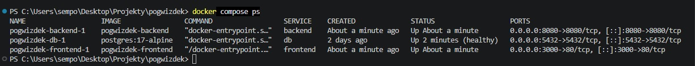
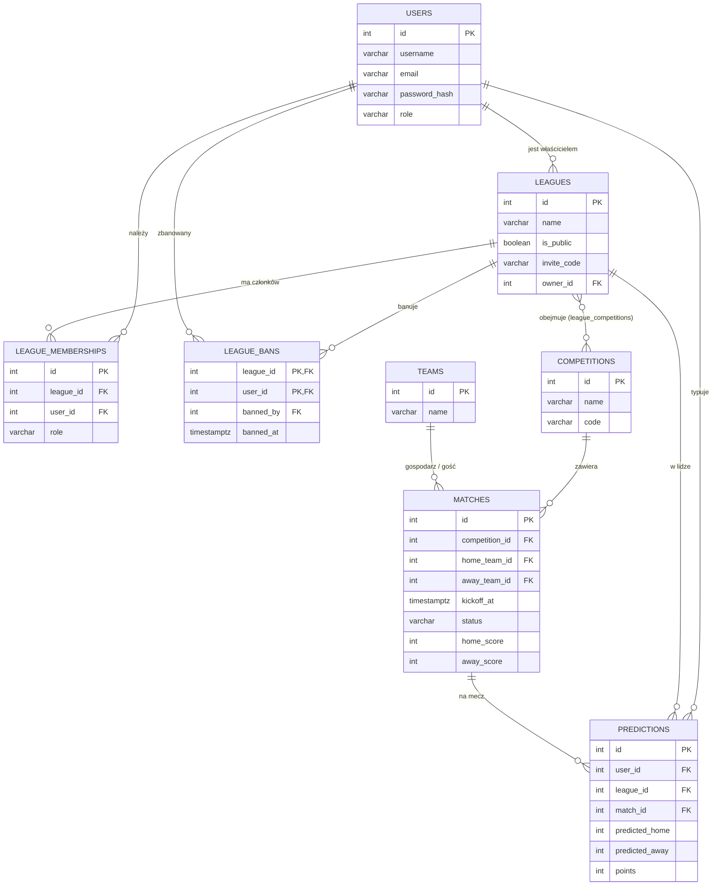
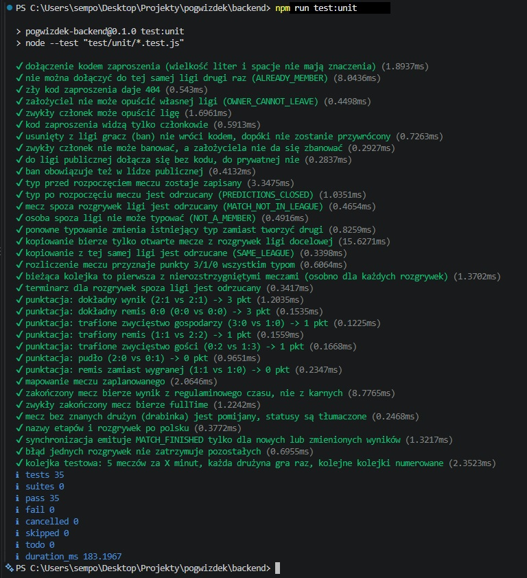
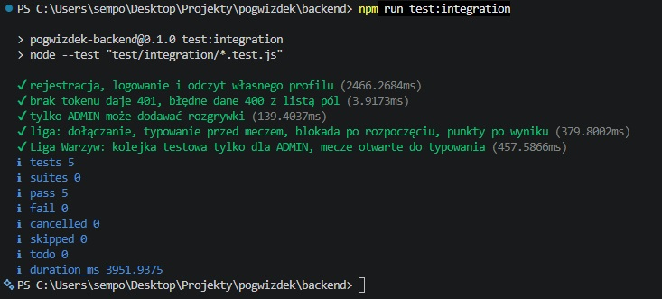

# Pogwizdek – typowanie meczów ze znajomymi

Aplikacja webowa do typowania wyników meczów piłkarskich w ligach znajomych.
Użytkownik zakłada konto, tworzy ligę albo do niej dołącza (może należeć do dowolnej liczby lig),
typuje wyniki do rozpoczęcia meczu i zbiera punkty w tabeli ligi. Terminarz i wyniki Ligi Mistrzów
oraz Premier League są pobierane z zewnętrznego API football-data.org.

## Demo

[](https://youtu.be/1j3aVz2fF7o)

Wideo: https://youtu.be/1j3aVz2fF7o

## Technologie

| Warstwa      | Technologia |
|--------------|-------------|
| Backend      | Node.js 22, Express 5, REST API |
| Baza danych  | PostgreSQL 17 (sterownik `pg`, zapytania SQL), migracje SQL |
| Logowanie    | JWT (`jsonwebtoken`), hasła hashowane `crypto.scrypt` |
| Dokumentacja | OpenAPI 3 + Swagger UI (`swagger-ui-express`) |
| Dane meczowe | API [football-data.org](https://www.football-data.org) v4 |
| Frontend     | React 19, Vite, React Router |
| Testy        | `node:test` (jednostkowe i integracyjne) |
| Uruchomienie | Docker Compose: kontenery `db`, `backend`, `frontend` |

## Uruchomienie

Wymagany Docker Desktop.

```bash
cp .env.example .env      # Windows: copy .env.example .env
docker compose up --build
```

W pliku `.env` należy ustawić hasła, `JWT_SECRET` oraz (opcjonalnie) `FOOTBALL_DATA_TOKEN` –
darmowy token z [football-data.org](https://www.football-data.org/client/register).

| Usługa      | Adres |
|-------------|-------|
| Frontend    | http://localhost:3000 |
| Backend API | http://localhost:8080/api |
| Swagger UI  | http://localhost:8080/api/docs |

Przy starcie backend wykonuje migracje bazy i zakłada konto administratora z ustawień `ADMIN_*`.
Z tokenem pobiera terminarz i wyniki od razu po starcie, a potem co 10 minut. Bez tokenu, przy
`LOAD_DEMO_DATA=true`, wczytuje przykładowe mecze.



## Główne funkcjonalności

- rejestracja i logowanie (JWT), role `USER` i `ADMIN`
- ligi prywatne (dołączenie kodem zaproszenia) i publiczne (lista od największych z wyszukiwaniem)
- zarządzanie ligą przez założyciela lub admina: edycja, usunięcie, usunięcie gracza (ban)
  i przywrócenie, przekazanie ligi; zwykły gracz może z ligi wyjść
- liga obejmuje wybrane rozgrywki (Liga Mistrzów, Premier League lub obie)
- terminarz ligi podzielony na kolejki; po wejściu do ligi otwiera się bieżąca kolejka
- typowanie wyniku, zmiana i usunięcie typu przed rozpoczęciem meczu
- kopiowanie własnych typów z innej ligi
- tabela ligi: top 10 na stronie ligi, pełna tabela z wyszukiwaniem po nicku
  i punktami z 5 ostatnich kolejek
- automatyczne, asynchroniczne liczenie punktów po zakończeniu meczu
- synchronizacja terminarza i wyników z football-data.org
- panel admina: testowa „Liga Warzyw” – kolejki meczów startujących za kilka minut
  i ręczne wpisywanie ich wyników

### Reguły biznesowe

1. Typ można dodać, zmienić lub usunąć tylko **przed rozpoczęciem meczu**.
2. Typuje się tylko mecze z rozgrywek obejmowanych przez ligę i tylko jako członek ligi.
3. Typy innych członków są **ukryte do rozpoczęcia meczu**.
4. Do ligi prywatnej dołącza się wyłącznie kodem zaproszenia, do każdej ligi tylko raz.
5. Gracz usunięty z ligi jest zbanowany – nie wróci ani kodem, ani z listy lig publicznych, dopóki
   założyciel albo admin go nie przywróci. Założyciela nie można usunąć.
6. Założyciel nie może opuścić ligi – najpierw ją przekazuje albo usuwa.
7. Wynik meczu można wpisać dopiero po jego rozpoczęciu; drużyna nie gra sama ze sobą.
8. Rozgrywek ligi nie można zmienić po jej założeniu (tabela straciłaby sens w trakcie sezonu).
9. Punktacja: 3 pkt – dokładny wynik, 1 pkt – trafiony rezultat, 0 – pudło.
10. Mecze z football-data.org (Liga Mistrzów, Premier League) zmienia wyłącznie synchronizacja –
    admin nie wpisze im wyniku ręcznie ani ich nie edytuje (oficjalny wynik i tak nadpisałby ręczny).
    Ręcznie wpisuje się wyniki meczów lokalnych, np. testowej Ligi Warzyw.

### Mechanizm asynchroniczny

Wpisanie wyniku meczu (ręcznie albo przez synchronizację) emituje zdarzenie `match.finished`
(`EventEmitter`). Listener `scoring.listener.js` poza obsługą requestu (`setImmediate`) przelicza
punkty wszystkich typów na ten mecz i emituje `predictions.scored`.

### Element rozszerzony: zewnętrzne API i harmonogram

Moduł `sync` pobiera z football-data.org mecze bieżącego sezonu (`FOOTBALL_DATA_COMPETITIONS`,
domyślnie `CL,PL`) zaraz po starcie serwera i potem co `FOOTBALL_DATA_INTERVAL_MINUTES` minut.

- zapis jako *upsert* po `external_id` – synchronizację można powtarzać bez dublowania danych,
  mecze jednych rozgrywek zapisują się w jednej transakcji;
- dla meczu, który się zakończył albo zmienił wynik, emitowane jest zdarzenie `match.finished`,
  więc punkty liczą się automatycznie;
- liczy się wynik po 90 minutach (`score.regularTime`), bez goli z serii rzutów karnych;
- błąd jednych rozgrywek nie zatrzymuje pozostałych;
- admin może uruchomić synchronizację ręcznie (`POST /api/sync`) i sprawdzić jej stan (`GET /api/sync/status`).

## Architektura

```
backend/
├── migrations/            pliki SQL wykonywane po kolei (tabela schema_migrations)
├── src/
│   ├── server.js          start: konfiguracja, migracje, dane demo, admin, nasłuch
│   ├── app.js             składanie aplikacji: repository -> service -> router
│   ├── config.js          jedyne miejsce czytające zmienne środowiskowe
│   ├── events.js          zdarzenia aplikacji
│   ├── common/            błędy, walidacja + stronicowanie, hashowanie haseł
│   ├── middleware/        logowanie requestów, JWT/role, obsługa błędów
│   ├── db/                pula połączeń + transakcje, migracje, dane demo
│   ├── docs/openapi.js    dokumentacja API
│   └── modules/           auth, users, competitions, matches, leagues, predictions, sync, testdata
│       └── <moduł>/       *.routes.js (HTTP) · *.service.js (logika) · *.repository.js (SQL)
└── test/                  unit/ i integration/
```

Przepływ requestu: **router** (adres, walidacja wejścia, kod HTTP) → **service** (reguły biznesowe,
bez wiedzy o HTTP) → **repository** (jedyne miejsce z SQL) → PostgreSQL. Błędy rzucane jako `AppError`
zamienia na jednolity JSON globalny `errorHandler`. Odpowiedzi API mają własny kształt (np. hash hasła
nigdy nie opuszcza repozytorium).

## Model danych (ERD)



## Dokumentacja REST API

Pełna dokumentacja: Swagger UI pod `/api/docs` (plik OpenAPI: `/api/openapi.json`).
Najważniejsze endpointy:

| Metoda | Endpoint | Opis |
|--------|----------|------|
| POST | `/api/auth/register`, `/api/auth/login` | rejestracja, logowanie (zwraca JWT) |
| GET | `/api/users/me` | zalogowany użytkownik |
| GET | `/api/leagues` | moje ligi |
| POST | `/api/leagues` | nowa liga |
| POST | `/api/leagues/join` | dołączenie kodem |
| GET | `/api/leagues/public` | ligi publiczne (od największych, `?q=` po nazwie) |
| POST | `/api/leagues/:id/join` | dołączenie do ligi publicznej bez kodu |
| DELETE | `/api/leagues/:id/members/:userId` | usunięcie gracza = ban (założyciel / admin) |
| GET, DELETE | `/api/leagues/:id/bans[/:userId]` | lista zbanowanych, przywrócenie |
| GET | `/api/leagues/:id/rounds` | kolejki ligi + bieżąca kolejka |
| GET | `/api/leagues/:id/fixtures` | terminarz ligi z moimi typami (kolejka, filtry, stronicowanie) |
| PUT | `/api/leagues/:id/matches/:matchId/prediction` | dodanie/zmiana typu |
| POST | `/api/leagues/:id/predictions/copy` | kopiowanie typów z innej ligi |
| GET | `/api/leagues/:id/leaderboard` | tabela ligi + punkty z 5 ostatnich kolejek (`?q=` po nicku) |
| GET | `/api/matches` | mecze z filtrami (stronicowanie) |
| PUT | `/api/matches/:id/result` | wynik meczu (ADMIN) |
| POST | `/api/sync` | ręczna synchronizacja z football-data.org (ADMIN) |
| POST | `/api/test-data/round` | Liga Warzyw: nowa kolejka testowa za X minut (ADMIN) |

## Testy

```bash
cd backend
npm run test:unit          # logika biznesowa, bez bazy
npm run test:integration   # REST API na PostgreSQL, wymaga `docker compose up -d db`
```

Testy integracyjne tworzą osobną bazę `<POSTGRES_DB>_test` przy każdym uruchomieniu.




