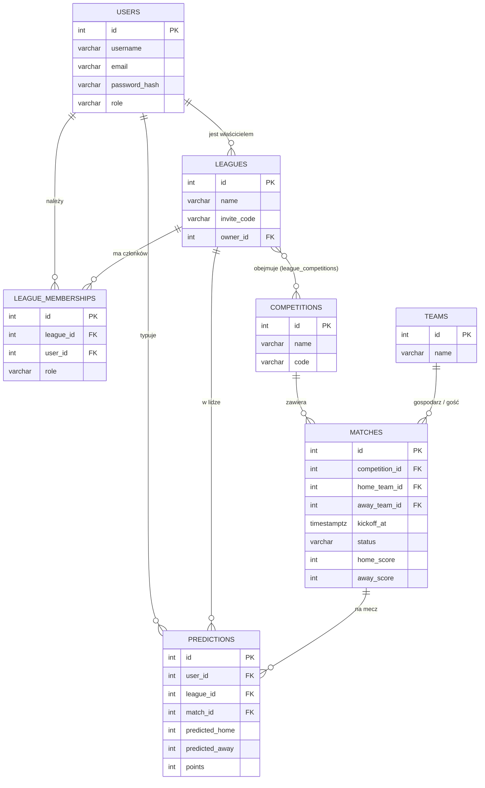

# Pogwizdek – typowanie meczów ze znajomymi

Aplikacja webowa do typowania wyników meczów piłkarskich w prywatnych ligach.
Użytkownik zakłada konto, tworzy ligę albo dołącza do niej kodem zaproszenia (może należeć do dowolnej
liczby lig), typuje wyniki do momentu rozpoczęcia meczu i zbiera punkty w tabeli ligi.

> Projekt zaliczeniowy z przedmiotu *Zaawansowane Technologie Programowania Aplikacji Internetowych*.

## Technologie

| Warstwa      | Technologia |
|--------------|-------------|
| Backend      | Node.js 22, Express 5, REST API |
| Baza danych  | PostgreSQL 17 (sterownik `pg`, zapytania SQL), własny mechanizm migracji |
| Logowanie    | JWT (`jsonwebtoken`), hasła hashowane wbudowanym `crypto.scrypt` |
| Dokumentacja | OpenAPI 3 + Swagger UI (`swagger-ui-express`) |
| Frontend     | React 19 + Vite, React Router |
| Testy        | wbudowany runner `node:test` (jednostkowe + integracyjne na prawdziwej bazie) |
| Uruchomienie | Docker Compose – osobne kontenery: `db`, `backend`, `frontend` |

Zależności są celowo ograniczone do minimum – walidacja, migracje, hashowanie haseł i testy
korzystają z tego, co daje Node.js.

## Uruchomienie (Docker Compose)

Wymagany Docker Desktop.

```bash
cp .env.example .env      # Windows: copy .env.example .env  – potem uzupełnij hasła i JWT_SECRET
docker compose up --build
```

| Usługa      | Adres |
|-------------|-------|
| Frontend    | http://localhost:3000 |
| Backend API | http://localhost:8080/api |
| Swagger UI  | http://localhost:8080/api/docs |

Przy starcie backend sam wykonuje migracje bazy, zakłada konto administratora z danych `ADMIN_*`
i (przy `LOAD_DEMO_DATA=true`) dodaje przykładowe rozgrywki – Ligę Mistrzów i Premier League –
z meczami rozegranymi, trwającym i nadchodzącymi (daty liczone od chwili uruchomienia).

## Uruchomienie w trybie developerskim

```bash
docker compose up -d db          # sama baza

cd backend
npm install
npm run dev                      # http://localhost:8080, restart po każdej zmianie w kodzie

cd ../frontend
npm install
npm run dev                      # http://localhost:5173, zapytania /api idą do :8080
```

Backend czyta konfigurację z pliku `.env` w katalogu głównym projektu.
Do ręcznego testowania API jest `backend/requests.http` (rozszerzenie REST Client w VS Code).

## Testy

```bash
cd backend
npm run test:unit          # logika biznesowa, bez bazy
npm run test:integration   # REST API na prawdziwym PostgreSQL – wymaga `docker compose up -d db`
npm test                   # wszystko
```

Testy integracyjne zakładają osobną bazę `<POSTGRES_DB>_test` od zera przy każdym uruchomieniu,
więc nie ruszają danych deweloperskich.

## Główne funkcjonalności

- rejestracja i logowanie (JWT), role globalne `USER` / `ADMIN`
- ligi: zakładanie, edycja, usuwanie, dołączanie kodem, opuszczanie, usuwanie członków, przekazanie ligi
- liga obejmuje wybrane rozgrywki (np. tylko Ligę Mistrzów albo LM + Premier League)
- terminarz ligi ze stronicowaniem i filtrowaniem (status, zakres dat)
- typowanie wyniku, zmiana i usunięcie typu przed rozpoczęciem meczu
- kopiowanie własnych typów z innej ligi
- automatyczne, asynchroniczne liczenie punktów po wpisaniu wyniku
- tabela ligi
- administracja (API): rozgrywki, drużyny, mecze, wyniki, role użytkowników

### Reguły biznesowe

1. Typ można dodać, zmienić lub usunąć tylko **przed rozpoczęciem meczu**.
2. Typuje się tylko mecze z rozgrywek obejmowanych przez ligę i tylko jako członek ligi.
3. Typy innych członków są **ukryte do rozpoczęcia meczu**.
4. Do ligi dołącza się wyłącznie kodem zaproszenia i tylko raz.
5. Właściciel nie może opuścić ligi – najpierw ją przekazuje albo usuwa.
6. Wynik meczu można wpisać dopiero po jego rozpoczęciu; drużyna nie gra sama ze sobą.
7. Punktacja (do dopracowania): 3 pkt – dokładny wynik, 1 pkt – trafiony rezultat, 0 – pudło.

### Mechanizm asynchroniczny

Wpisanie wyniku (`PUT /api/matches/:id/result`) emituje zdarzenie `match.finished` przez wbudowany
w Node `EventEmitter`. Listener z modułu typów (`scoring.listener.js`) poza obsługą requestu
(`setImmediate`) przelicza punkty wszystkich typów na ten mecz i emituje `predictions.scored`.

## Architektura

```
backend/
├── migrations/            pliki SQL wykonywane po kolei (tabela schema_migrations)
├── src/
│   ├── server.js          start: konfiguracja, migracje, dane demo, admin, nasłuch
│   ├── app.js             składanie aplikacji: repository -> service -> router
│   ├── config.js          jedyne miejsce czytające zmienne środowiskowe
│   ├── events.js          zdarzenia aplikacji
│   ├── common/            błędy, walidacja + stronicowanie, hashowanie haseł
│   ├── middleware/        logowanie requestów, JWT/role, obsługa błędów
│   ├── db/                pula połączeń + transakcje, migracje, dane demo
│   ├── docs/openapi.js    dokumentacja API
│   └── modules/           auth, users, competitions, matches, leagues, predictions
│       └── <moduł>/       *.routes.js (HTTP) · *.service.js (logika) · *.repository.js (SQL)
└── test/                  unit/ i integration/
```

Przepływ requestu: **router** (adres, walidacja wejścia, kod HTTP) → **service** (reguły biznesowe,
bez wiedzy o HTTP) → **repository** (jedyne miejsce z SQL) → PostgreSQL. Błędy rzucane jako `AppError`
zamienia na jednolity JSON globalny `errorHandler`. Odpowiedzi API mają własny kształt (np. hash hasła
nigdy nie opuszcza repozytorium).

## Model danych (ERD)



## Dokumentacja REST API

Pełna dokumentacja: Swagger UI pod `/api/docs` (surowy plik: `/api/openapi.json`). Najważniejsze endpointy:

| Metoda | Endpoint | Opis |
|--------|----------|------|
| POST | `/api/auth/register`, `/api/auth/login` | rejestracja, logowanie (zwraca JWT) |
| GET | `/api/users/me` | zalogowany użytkownik |
| GET | `/api/leagues` | moje ligi |
| POST | `/api/leagues` | nowa liga |
| POST | `/api/leagues/join` | dołączenie kodem |
| GET | `/api/leagues/:id/fixtures` | terminarz ligi z moimi typami (stronicowanie) |
| PUT | `/api/leagues/:id/matches/:matchId/prediction` | dodanie/zmiana typu |
| POST | `/api/leagues/:id/predictions/copy` | kopiowanie typów z innej ligi |
| GET | `/api/leagues/:id/leaderboard` | tabela ligi |
| GET | `/api/matches` | mecze z filtrami (stronicowanie) |
| PUT | `/api/matches/:id/result` | wynik meczu (ADMIN) |

## Plany

- synchronizacja terminarza i wyników z [football-data.org](https://www.football-data.org) (scheduler)
- ustalenie docelowej punktacji
- wygląd frontendu w klimacie retro gazety piłkarskiej, panel admina na frontendzie
- CI w GitHub Actions
