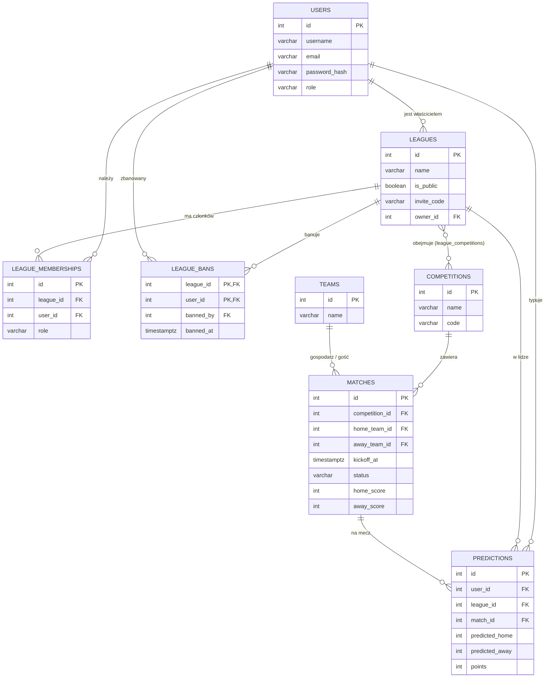

# Pogwizdek – typowanie meczów ze znajomymi

Aplikacja webowa do typowania wyników meczów piłkarskich w prywatnych ligach.
Użytkownik zakłada konto, tworzy ligę albo dołącza do niej kodem zaproszenia (może należeć do dowolnej
liczby lig), typuje wyniki do momentu rozpoczęcia meczu i zbiera punkty w tabeli ligi.

> Projekt zaliczeniowy z przedmiotu *Zaawansowane Technologie Programowania Aplikacji Internetowych*.

## Technologie

| Warstwa      | Technologia |
|--------------|-------------|
| Backend      | Node.js 22, Express 5, REST API |
| Baza danych  | PostgreSQL 17 (sterownik `pg`, zapytania SQL), własny mechanizm migracji |
| Logowanie    | JWT (`jsonwebtoken`), hasła hashowane wbudowanym `crypto.scrypt` |
| Dokumentacja | OpenAPI 3 + Swagger UI (`swagger-ui-express`) |
| Dane meczowe | zewnętrzne API [football-data.org](https://www.football-data.org) (v4), wbudowany `fetch` |
| Frontend     | React 19 + Vite, React Router; wygląd w stylu angielskiego programu meczowego z lat 70. |
| Testy        | wbudowany runner `node:test` (jednostkowe + integracyjne na prawdziwej bazie) |
| Uruchomienie | Docker Compose – osobne kontenery: `db`, `backend`, `frontend` |

Zależności są celowo ograniczone do minimum – walidacja, migracje, hashowanie haseł i testy
korzystają z tego, co daje Node.js.

## Uruchomienie (Docker Compose)

Wymagany Docker Desktop.

```bash
cp .env.example .env      # Windows: copy .env.example .env  – potem uzupełnij hasła i JWT_SECRET
docker compose up --build
```

| Usługa      | Adres |
|-------------|-------|
| Frontend    | http://localhost:3000 |
| Backend API | http://localhost:8080/api |
| Swagger UI  | http://localhost:8080/api/docs |

Przy starcie backend sam wykonuje migracje bazy i zakłada konto administratora z danych `ADMIN_*`.

Skąd biorą się mecze:
- **z tokenem `FOOTBALL_DATA_TOKEN`** (darmowy, [rejestracja](https://www.football-data.org/client/register)) –
  backend pobiera prawdziwy terminarz i wyniki Ligi Mistrzów i Premier League od razu po starcie,
  a potem co 10 minut;
- **bez tokenu** – przy `LOAD_DEMO_DATA=true` dodawane są przykładowe mecze: rozegrane, trwający
  i nadchodzące (daty liczone od chwili uruchomienia).

## Uruchomienie w trybie developerskim

```bash
docker compose up -d db          # sama baza

cd backend
npm install
npm run dev                      # http://localhost:8080, restart po każdej zmianie w kodzie

cd ../frontend
npm install
npm run dev                      # http://localhost:5173, zapytania /api idą do :8080
```

Backend czyta konfigurację z pliku `.env` w katalogu głównym projektu.
Do ręcznego testowania API jest `backend/requests.http` (rozszerzenie REST Client w VS Code).

## Testy

```bash
cd backend
npm run test:unit          # logika biznesowa, bez bazy
npm run test:integration   # REST API na prawdziwym PostgreSQL – wymaga `docker compose up -d db`
npm test                   # wszystko
```

Testy integracyjne zakładają osobną bazę `<POSTGRES_DB>_test` od zera przy każdym uruchomieniu,
więc nie ruszają danych deweloperskich.

### Testowanie ręczne: Liga Warzyw

Prawdziwe mecze trwają dni, więc do testów i demo jest testowa „Liga Warzyw”
(Kalafior FC, Marchewka United, Sporting Brokuł…). Reguły są te same co dla prawdziwych meczów.

1. Zaloguj się jako admin w Swaggerze (`/api/docs`): `POST /api/auth/login`, potem **Authorize** z tokenem.
2. `POST /api/test-data/round` z `{"minutes": 3}` – nowa kolejka 5 meczów startujących za 3 minuty.
3. W aplikacji załóż ligę z rozgrywkami „Liga Warzyw” i obstaw mecze.
4. Po 3 minutach typowanie się zamyka. Wpisz wynik ręcznie (`PUT /api/matches/{id}/result`)
   albo losowo wszystkim rozpoczętym meczom (`POST /api/test-data/results`).
5. Punkty liczą się w tle – odśwież tabelę ligi.

Liga Warzyw nie jest synchronizowana z football-data.org, więc nic jej nie nadpisze.

## Główne funkcjonalności

- rejestracja i logowanie (JWT), role globalne `USER` / `ADMIN`
- ligi prywatne (dołączenie kodem zaproszenia) i publiczne (lista lig od największych z wyszukiwaniem, dołączenie bez kodu)
- zarządzanie ligą przez założyciela lub admina: edycja nazwy, opisu i widoczności, usunięcie ligi,
  usunięcie gracza (ban) i jego przywrócenie, przekazanie ligi innemu graczowi; zwykły gracz może z ligi wyjść
- tabela ligi: top 10 na stronie ligi, pełna tabela z wyszukiwaniem po nicku, datą dołączenia
  i punktami z 5 ostatnich kolejek
- liga obejmuje wybrane rozgrywki (np. tylko Ligę Mistrzów albo LM + Premier League)
- terminarz ligi podzielony na kolejki – po wejściu do ligi otwiera się bieżąca kolejka
  (do typowania albo właśnie rozliczana); stronicowanie i filtrowanie w API
- typowanie wyniku, zmiana i usunięcie typu przed rozpoczęciem meczu
- kopiowanie własnych typów z innej ligi
- automatyczne, asynchroniczne liczenie punktów po wpisaniu wyniku
- automatyczna synchronizacja terminarza i wyników z football-data.org
- tabela ligi
- administracja (API): rozgrywki, drużyny, mecze, wyniki, role użytkowników

### Reguły biznesowe

1. Typ można dodać, zmienić lub usunąć tylko **przed rozpoczęciem meczu**.
2. Typuje się tylko mecze z rozgrywek obejmowanych przez ligę i tylko jako członek ligi.
3. Typy innych członków są **ukryte do rozpoczęcia meczu**.
4. Do ligi prywatnej dołącza się wyłącznie kodem zaproszenia, do każdej ligi tylko raz.
5. Gracz usunięty z ligi jest zbanowany – nie wróci ani kodem, ani z listy lig publicznych, dopóki
   założyciel albo admin go nie przywróci. Założyciela nie można usunąć.
6. Założyciel nie może opuścić ligi – najpierw ją przekazuje albo usuwa.
7. Wynik meczu można wpisać dopiero po jego rozpoczęciu; drużyna nie gra sama ze sobą.
8. Rozgrywek ligi nie można zmienić po jej założeniu (tabela straciłaby sens w trakcie sezonu).
9. Punktacja (do dopracowania): 3 pkt – dokładny wynik, 1 pkt – trafiony rezultat, 0 – pudło.

### Mechanizm asynchroniczny

Wpisanie wyniku (`PUT /api/matches/:id/result`) emituje zdarzenie `match.finished` przez wbudowany
w Node `EventEmitter`. Listener z modułu typów (`scoring.listener.js`) poza obsługą requestu
(`setImmediate`) przelicza punkty wszystkich typów na ten mecz i emituje `predictions.scored`.

### Element rozszerzony: integracja z zewnętrznym API + harmonogram

Moduł `sync` pobiera z football-data.org wszystkie mecze bieżącego sezonu wybranych rozgrywek
(`FOOTBALL_DATA_COMPETITIONS`, domyślnie `CL,PL`) – zaraz po starcie serwera (nadrabia to, co działo się,
gdy aplikacja była wyłączona), a potem co `FOOTBALL_DATA_INTERVAL_MINUTES` minut.

- drużyny i mecze są zapisywane jako *upsert* po `external_id`, więc synchronizację można powtarzać
  bez dublowania danych; mecze jednych rozgrywek zapisują się w jednej transakcji;
- dla meczu, który właśnie się zakończył albo zmienił mu się wynik, emitowane jest to samo zdarzenie
  `match.finished` co przy ręcznym wpisaniu wyniku – punkty liczą się same;
- liczy się wynik po 90 minutach (`score.regularTime`), bo `fullTime` po serii rzutów karnych wlicza
  gole z karnych (np. 7:6);
- błąd jednych rozgrywek (np. brak dostępu w darmowym planie, limit 10 zapytań/min) nie zatrzymuje pozostałych;
- admin może uruchomić synchronizację ręcznie (`POST /api/sync`) i podejrzeć jej stan (`GET /api/sync/status`).

## Architektura

```
backend/
├── migrations/            pliki SQL wykonywane po kolei (tabela schema_migrations)
├── src/
│   ├── server.js          start: konfiguracja, migracje, dane demo, admin, nasłuch
│   ├── app.js             składanie aplikacji: repository -> service -> router
│   ├── config.js          jedyne miejsce czytające zmienne środowiskowe
│   ├── events.js          zdarzenia aplikacji
│   ├── common/            błędy, walidacja + stronicowanie, hashowanie haseł
│   ├── middleware/        logowanie requestów, JWT/role, obsługa błędów
│   ├── db/                pula połączeń + transakcje, migracje, dane demo
│   ├── docs/openapi.js    dokumentacja API
│   └── modules/           auth, users, competitions, matches, leagues, predictions, sync
│       └── <moduł>/       *.routes.js (HTTP) · *.service.js (logika) · *.repository.js (SQL)
└── test/                  unit/ i integration/
```

Przepływ requestu: **router** (adres, walidacja wejścia, kod HTTP) → **service** (reguły biznesowe,
bez wiedzy o HTTP) → **repository** (jedyne miejsce z SQL) → PostgreSQL. Błędy rzucane jako `AppError`
zamienia na jednolity JSON globalny `errorHandler`. Odpowiedzi API mają własny kształt (np. hash hasła
nigdy nie opuszcza repozytorium).

## Model danych (ERD)



## Dokumentacja REST API

Pełna dokumentacja: Swagger UI pod `/api/docs` (surowy plik: `/api/openapi.json`). Najważniejsze endpointy:

| Metoda | Endpoint | Opis |
|--------|----------|------|
| POST | `/api/auth/register`, `/api/auth/login` | rejestracja, logowanie (zwraca JWT) |
| GET | `/api/users/me` | zalogowany użytkownik |
| GET | `/api/leagues` | moje ligi |
| POST | `/api/leagues` | nowa liga |
| POST | `/api/leagues/join` | dołączenie kodem |
| GET | `/api/leagues/public` | ligi publiczne (od największych, `?q=` po nazwie) |
| POST | `/api/leagues/:id/join` | dołączenie do ligi publicznej bez kodu |
| DELETE | `/api/leagues/:id/members/:userId` | usunięcie gracza = ban (założyciel / admin) |
| GET, DELETE | `/api/leagues/:id/bans[/:userId]` | lista zbanowanych, przywrócenie |
| GET | `/api/leagues/:id/rounds` | kolejki ligi + bieżąca kolejka |
| GET | `/api/leagues/:id/fixtures` | terminarz ligi z moimi typami (kolejka, filtry, stronicowanie) |
| PUT | `/api/leagues/:id/matches/:matchId/prediction` | dodanie/zmiana typu |
| POST | `/api/leagues/:id/predictions/copy` | kopiowanie typów z innej ligi |
| GET | `/api/leagues/:id/leaderboard` | tabela ligi + punkty z 5 ostatnich kolejek (`?q=` po nicku) |
| GET | `/api/matches` | mecze z filtrami (stronicowanie) |
| PUT | `/api/matches/:id/result` | wynik meczu (ADMIN) |
| POST | `/api/sync` | ręczna synchronizacja z football-data.org (ADMIN) |
| POST | `/api/test-data/round` | Liga Warzyw: nowa kolejka testowa za X minut (ADMIN) |
| POST | `/api/test-data/results` | Liga Warzyw: losowe wyniki rozpoczętych meczów (ADMIN) |

## Plany

- ustalenie docelowej punktacji
- panel admina na frontendzie (dziś: Swagger UI)
- CI w GitHub Actions
